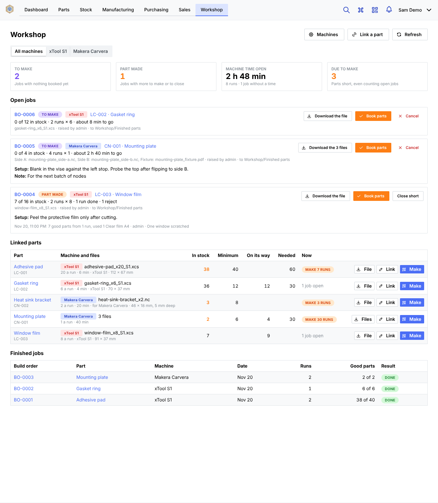
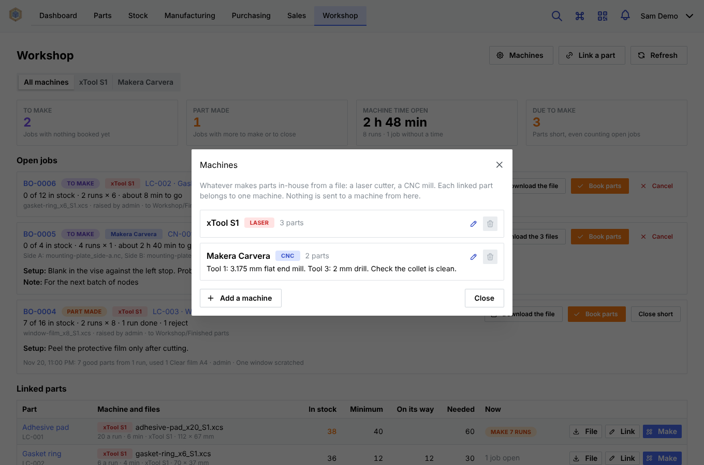
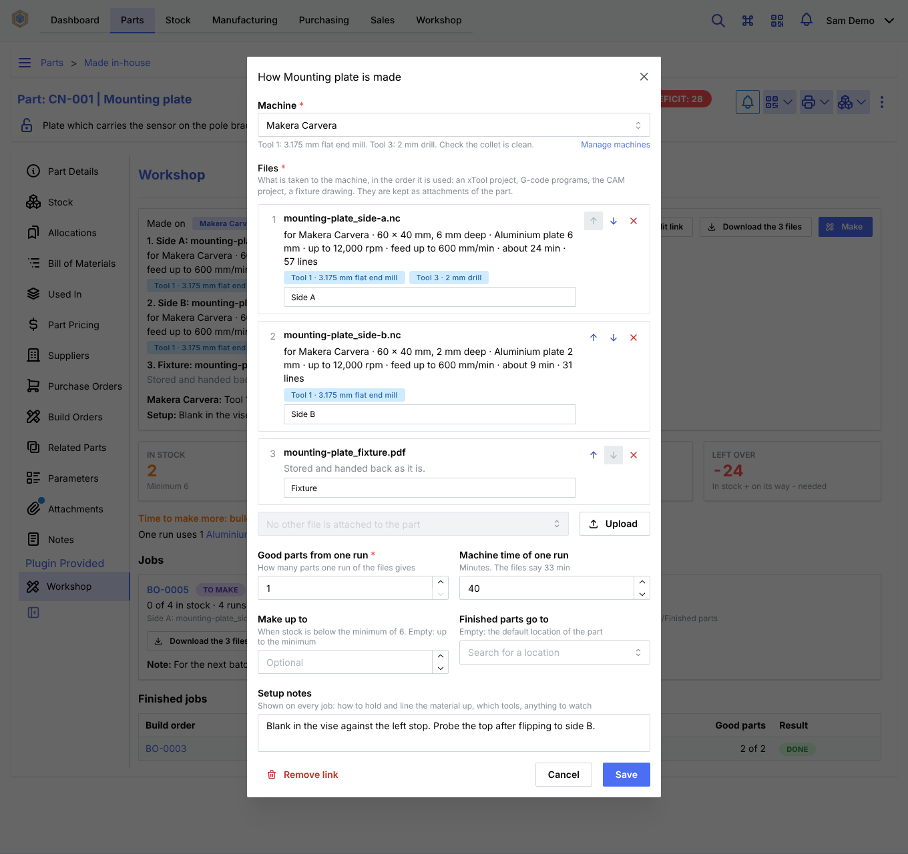
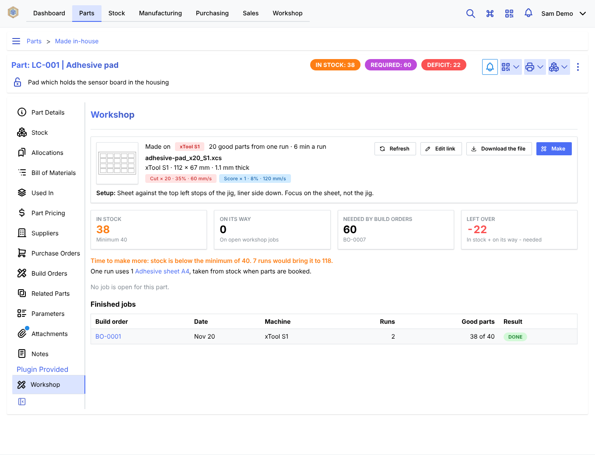
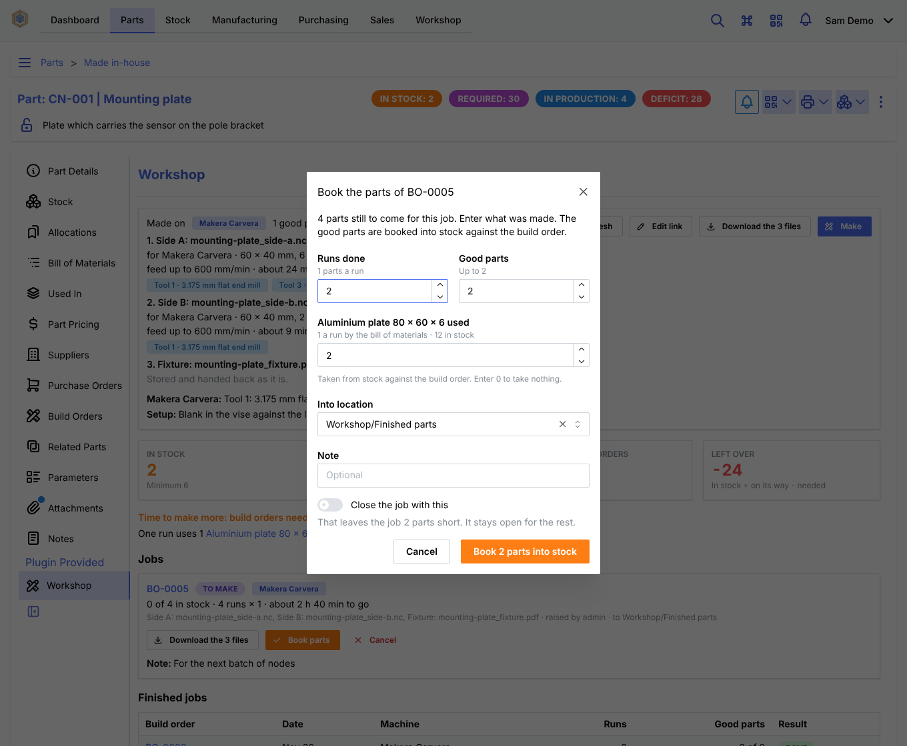
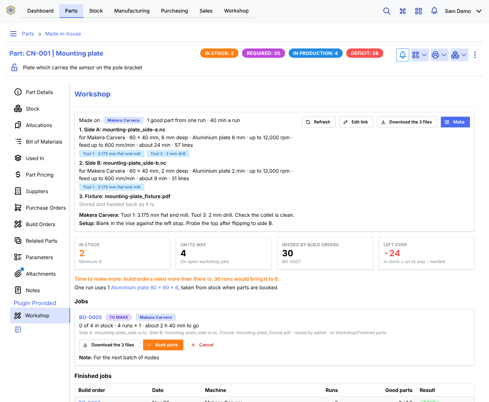

# InvenTree Workshop

Jobs for parts which are made in-house on a machine from a file, for
[InvenTree](https://inventree.org): cut on a laser, milled on a desktop CNC,
and so on. Written around an xTool laser and a Makera Carvera, but a machine
is only a name here, so it fits anything which is set up and run by hand.

- List your machines.
- Keep the files which make a part with the part (an xTool project, G-code
  programs, the CAM project, a fixture drawing), with its machine and how many
  good parts one run gives.
- Press **Make** on the part page. The plugin raises a build order for whole
  runs, so the parts count as on their way.
- Download the files, set the machine up and run it.
- Book what came out. The good parts go into stock against the build order,
  and the sheet or blank the runs used comes out of stock.
- See which parts are due: below their minimum stock, or needed by build
  orders in production, and how much machine time is waiting on each machine.

**Nothing is sent to any machine.** The material has to be loaded and lined up
by hand for every run in any case. The plugin looks after everything around
the run: which files, how many, what is in stock.

Built and tested against InvenTree 1.7.3.

## How it works

### Machines

A machine has a name, a kind (laser, CNC or other) and notes which are shown
with every part made on it: which tool is in which slot, what to check first.
The kind only decides a colour. Each linked part belongs to one machine. A
machine with parts linked to it cannot be removed.

### The link

| | |
|---|---|
| Machine | The machine which makes the part |
| Files | One or more attachments of the part, in the order they are used, each with an optional label ("Side A") |
| Good parts from one run | How many parts one run of the files gives |
| Machine time of one run | Minutes, optional. Adds up to the time waiting on a machine |
| Make up to | The stock level to suggest making up to. Default: the minimum stock of the part |
| Finished parts go to | Stock location. Default: the default location of the part |
| Setup notes | Shown on every job: how to hold and line the material up, which tools |

The files are ordinary attachments of the part: they show on its Attachments
tab and are backed up with the rest of InvenTree. The link is stored in the
metadata of the part, under the key `workshop`. InvenTree only raises build
orders for assemblies, so linking a part marks it as an assembly.

A part which is made in two steps on two machines is two parts in InvenTree,
the second with the first on its bill of materials.

### What is read from the files

Two kinds of file are read, to show people what they are. That is all it is
for: every file is stored and handed back byte for byte, and any other kind of
file can be linked as well.

| File | What is shown |
|---|---|
| xTool project (`.xcs`) | Machine model, the area the shapes cover, material thickness, how many shapes are cut, scored or engraved with which power and speed, the preview picture. The number of shapes set to cut fills in the parts per run |
| G-code (`.nc`, `.gcode`, `.cnc`, `.ngc`, `.tap`) | The tools it calls, the highest spindle speed and feed, how far the cutter travels and how deep, whether it uses the rotary axis. Programs from Makera's CAM software carry a header: from it come the names of the tools, the material and the running time, which fills in the machine time |

A SHA-256 hash of each file is kept with the link. If an attachment is deleted
the link says which file is gone, and no job can be raised until the part is
linked again. Each job records the hashes of the files it was raised with.

### A job

A job is a build order.

1. **Make**: enter the parts needed. It is rounded up to whole runs, and a
   build order is raised for runs × parts per run, titled
   "Makera Carvera: 3 runs of …". It is issued straight away, so the
   outstanding quantity counts as incoming stock everywhere in InvenTree.
2. **Download** the files from the job: the file itself, or a zip when there
   are several. Take them to the machine and run them.
3. **Book parts**: enter the runs done and the good parts. A build output is
   created for the good parts and completed into stock. Rejects are simply not
   booked.
4. When the build order has its quantity it is completed. If it is short, the
   job stays open for the rest ("Part made"), or is closed short. A job with
   nothing in stock can be cancelled.

What the plugin knows about a job is stored in the metadata of the build
order, under the key `workshop`. A job keeps the machine name, the files and
the time it was raised with, even if the link is changed afterwards.

### Material

If the part has a bill of materials, the build order has a line for each
material, as for any build order. When parts are booked, the plugin takes the
material the runs used from stock against those lines (allocated and consumed
in one step), so it shows as consumed on the build order.

- The quantity offered is what the bill of materials says for the parts on the
  runs, whether they turned out good or not: 0.05 of a sheet per part and 20
  parts a run is one sheet a run. It can be changed, or set to 0.
- Stock in the source location of the build order is used first, then the
  oldest stock.
- Consumable lines are not taken from stock (as elsewhere in InvenTree), and
  neither are materials tracked by serial number.

A part needs to be an assembly to have a bill of materials, so add it after
linking. Without one, booking only adds the finished parts.

### When to make more

For each linked part:

    left over = in stock + on its way (open build orders) - needed by build orders in production

When that is below the minimum stock of the part (zero if none is set), the
part page and the Workshop page say how many runs to make, up to the minimum
or the "Make up to" level. Open jobs count as on their way, so a shortage is
only suggested once. Nothing is raised automatically.

The Workshop page can be narrowed to one machine, and adds up the machine time
of the runs still to do on open jobs.

## Installation

### 1. Install the plugin

In the InvenTree web interface: *Admin Center → Plugins → Install Plugin*, with

- Package name: `inventree-workshop`
- Source URL: `git+https://github.com/nemccarthy/inventree-workshop@main`

Or add this line to `plugins.txt` in the InvenTree data directory:

    inventree-workshop @ git+https://github.com/nemccarthy/inventree-workshop@main

To install from a wheel instead, copy it into the data directory and put its
path as seen from inside the container in `plugins.txt`, for example
`/home/inventree/data/wheels/inventree_workshop-0.1.0-py3-none-any.whl`.

### 2. Switch on what it needs

In *Admin Center → Plugins → Plugin Settings*:

- **Enable URL integration**: the plugin's API
- **Enable interface integration**: the panel and the page
- **Check plugins on startup** (Docker)

Then activate **Workshop** in the plugin list.

### 3. Update and restart (Docker)

From the directory with the InvenTree compose file:

    docker compose run --rm inventree-server invoke update
    docker compose restart inventree-server inventree-worker

This installs the plugin in the worker as well as the server, and copies the
compiled frontend into InvenTree's static files. Repeat it after every update
of the plugin. Without it the page shows "Failed to load module".

### 4. Add your machines

Open **Workshop** in the navigation bar, then **Machines**.

### 5. Plugin settings

| Setting | Default | |
|---|---|---|
| Count pending build orders | off | Also count the requirements of build orders which have not been issued yet |
| Days until parts are in stock | 1 | Target date of a job's build order |
| Stock location for finished parts | | Used when neither the link nor the part has a location |
| Show in the navigation bar | on | The Workshop link |
| Show on part pages | on | The Workshop panel |
| Only on linked parts | off | Hide the panel on parts without a link |

Uploads are limited by InvenTree's own "Upload size limit" setting, and by the
proxy in front of it.

## Permissions

| To | A user needs |
|---|---|
| See the page and the panel, download files | *view* on Part |
| Link a part, upload a file, manage the machines | *change* on Part |
| Raise a job | *add* on Build Orders |
| Book parts, close or cancel a job | *change* on Build Orders |

## API

Below `/plugin/workshop/`, with session or token authentication.

| | |
|---|---|
| `GET overview/` | Machines, every linked part with its numbers, every open job |
| `GET machines/` | The machines |
| `POST machines/` | Add one: `{"name": "Makera Carvera", "kind": "cnc", "notes": ""}` (kind: `laser`, `cnc`, `other`) |
| `PUT machines/<id>/`, `DELETE machines/<id>/` | Change or remove one |
| `GET part/<id>/` | A part: link, numbers, suggestion, jobs |
| `PUT part/<id>/` | Link: `{"machine": 2, "files": [{"attachment": 31, "label": "Side A"}], "parts_per_run": 4, "run_minutes": 25, "restock_to": 40, "destination": 7, "setup_notes": ""}` |
| `DELETE part/<id>/` | Remove the link (the files and the jobs stay) |
| `GET part/<id>/files/` | The attachments of the part. `?describe=<attachment>` reads one |
| `POST part/<id>/files/` | Attach a file (form field `file`) |
| `GET part/<id>/download/` | The linked files: the file, or a zip of them |
| `GET part/<id>/file/<attachment>/` | One file of the part |
| `GET part/<id>/preview/?attachment=<id>` | The preview picture in a file |
| `POST part/<id>/make/` | Raise a job: `{"runs": 2}` or `{"quantity": 30}`, optional `notes` |
| `GET job/<build id>/` | A job |
| `GET job/<build id>/download/` | The files of the job: the file, or a zip |
| `GET job/<build id>/file/<attachment>/` | One file of the job |
| `POST job/<build id>/book/` | `{"good": 18, "runs": 1, "location": 7, "notes": "", "finish": false, "material": [{"line": 91, "quantity": 1}]}` |
| `POST job/<build id>/close/` | Complete the build order as it stands |
| `POST job/<build id>/cancel/` | Cancel a job with nothing in stock |

In a booking, `material` may be left out: every material then uses what the
bill of materials says. `finish` closes the job even if it is short (and
cancels it if nothing good came out at all).

## Limits

- No machine is controlled, and no job status comes back from one.
- One machine and one yield per part. A run is one part type.
- Parts are whole numbers and are booked as one batch: no serial numbers.
- The xTool project format is not published. The reader was written from
  project files saved by xTool Creative Space 2.2. The summary describes the
  canvas which was open when the project was saved.
- G-code: travel is measured at the end points of cutting moves, so large arcs
  can reach a little further than shown. Only the first 200,000 lines of a
  program are read. Coordinates set by variables or sub-programs are not
  followed.
- A file which is not understood is stored and linked all the same, without
  the details.
- Demand comes from build orders for the exact part (no variants,
  substitutes or sales orders).
- InvenTree completes and cancels build orders in the background when its
  worker is running, so a job closed from the build order page can show as
  open for a moment.
- If the InvenTree setting "Require valid BOM" for build orders is on, a job
  for a part with an empty or unvalidated bill of materials is refused.

## Development

    cd frontend
    npm ci
    npm run build        # writes inventree_workshop/static/

The compiled frontend is committed, so the plugin installs straight from git.
CI fails if it does not match the source.

    python -m pip install pytest
    python -m pytest tests

`tests/` covers the rules (runs, when to make more, the state of a job,
material), the machines and the file readers in plain Python.
`dev/integration_check.py` runs the whole flow against a live InvenTree, for a
throwaway setup only. `dev/seed_demo.py` fills such a setup with made-up data;
`dev/make_xcs.py` and `dev/make_gcode.py` write stand-in files.

To release: bump `PLUGIN_VERSION` in `inventree_workshop/__init__.py` and
`version` in `frontend/package.json`, update `CHANGELOG.md`, then push a tag
`vX.Y.Z`.

## Licence

MIT. xTool and Makera are trademarks of their owners; this plugin is not
affiliated with or endorsed by either.
